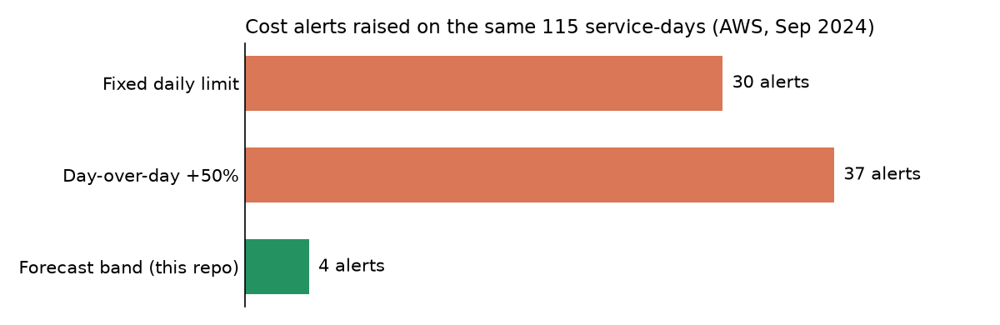
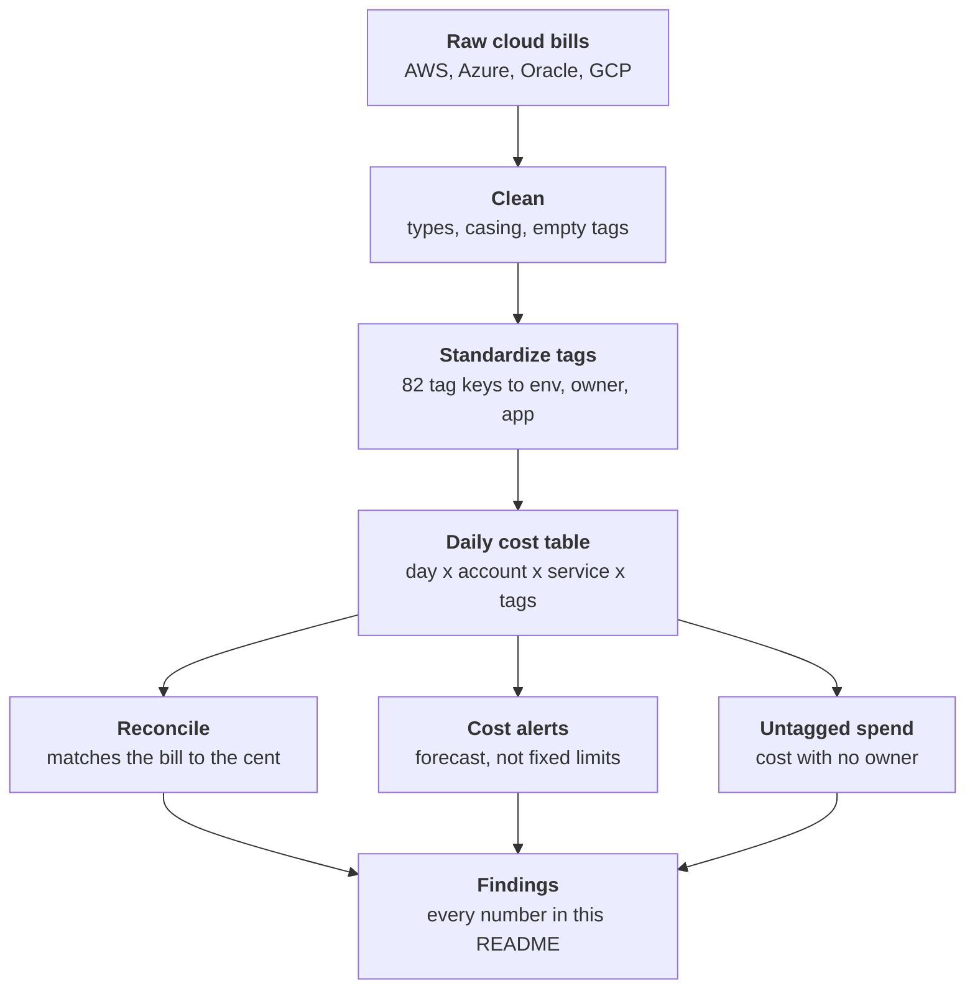
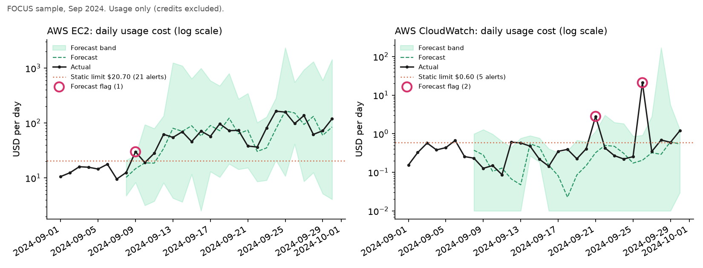

# Multi-cloud FinOps cost mart

**Raw cloud bills in. Cost tables that tie back to the bill to the cent, a savings case, and 4 cost alerts out, where the usual rules raise 30 or more.**

| | |
|---|---|
| **Problem** | FinOps numbers are only useful if they match the bill, and the usual cost alerts fire so often that people stop reading them. |
| **What I built** | A dbt pipeline that cleans and reconciles raw billing data, plus an alert check that compares each day with a forecast instead of a fixed dollar limit. |
| **Data** | The FinOps Foundation's public [FOCUS 1.0 sample](https://github.com/FinOps-Open-Cost-and-Usage-Spec/FOCUS-Sample-Data): 100,000 rows of anonymized real billing (AWS, Azure, Oracle, GCP), Sep 2024. |
| **Stack** | dbt, SQL, DuckDB (runs on a laptop, no cloud account), Python. 21 dbt tests and 10 unit tests, all passing. |
| **Run it** | `pip install -r requirements.txt` then `python scripts/run_pipeline.py` |

## What it found

1. **The numbers tie out.** 100,000 rows in, 100,000 out, $0.00 difference from the bill. A test stops the build if that ever breaks.
2. **4 alerts instead of 30.** On the same days, a fixed daily limit fired 30 times and a "+50% since yesterday" rule 37 times. The forecast check fired 4 times, including CloudWatch at $21.03 on a day forecast at $0.20.
3. **The savings case: dev machines running at night.** 81% of AWS spend is tagged `dev`, and 63% of dev EC2 spend ($968 of $1,529) ran outside weekday working hours.



## Architecture



<details>
<summary>Which dbt model does each step</summary>

| Step | Model | Grain / job |
|---|---|---|
| Raw | `raw.focus_charges` | The sample file, loaded unchanged by `scripts/load_raw.py` |
| Clean | `stg_focus__charges` | One row per charge, typed, enums lowercased, `'NULL'` tag strings set to null |
| Standardize tags | `int_charge_tags` + seed `tag_key_map` | One row per tagged charge: environment, owner, application |
| Daily cost table | `fct_daily_cost` | Day x provider x account x service x region x charge type x tags |
| Reconcile | `mart_reconciliation` + 2 singular tests | Mart vs raw per provider and charge type, rows and every cost measure |
| Cost alerts | `mart_daily_usage` + `finops/anomaly.py` | Usage per day and service on a full date spine, scored by the forecast check |
| Attribution gaps | `mart_tag_coverage` | Usage cost with no owner or environment, per provider and service |
| Findings | `scripts/findings.py` | Writes `outputs/findings.json` |

</details>

## Findings in detail

All figures are from `outputs/findings.json`, written by `scripts/findings.py`. They describe this 100,000-row sample only, so the dollar amounts are small; the shapes are what matter.

### 1. Reconcile first: two traps in the raw data

| Check | Result |
|---|---|
| Rows, source vs mart | 100,000 vs 100,000 |
| Billed cost difference, worst provider x category | $0.00 |
| AWS usage: billed vs effective cost | $2,027.75 vs $1,493.32 |
| Non-zero AWS EffectiveCost values that are whole dollars | 814 of 821 |
| Non-zero AWS BilledCost values that are whole dollars | 29 of 62,064 |

**EffectiveCost is rounded to whole dollars in this sample**, most likely by the anonymization. Summing it understates AWS usage by about a quarter. The mart keeps both columns and reconciles both, but the analysis uses BilledCost. In a real bill I would expect EffectiveCost to be the better number (it spreads commitment purchases over usage); the point is to test that before trusting it.

**Credits make net cost useless for alerting.** AWS credits total $1,196.45, which is 59% of AWS usage, and they land in lumps: 6 of 30 days have negative net cost. A check on net cost would see those days as huge drops. `mart_daily_usage` keeps usage only, so the anomaly check never sees credits.

### 2. Anomaly check: forecast band vs the usual rules

Each day is compared with a forecast built from the previous 7 daily changes (median change for the trend, MAD for a spread that one old spike cannot inflate, band of 3.5 robust standard deviations, $1 minimum). The forecast moves with growth, so a planned ramp is not an alert; a break from the pattern is.

| Service (AWS) | Month usage | Forecast flags | Static limit flags | Day-over-day +50% flags |
|---|---:|---:|---:|---:|
| EC2 | $1,757.01 | 1 | 21 | 7 |
| CloudWatch | $34.62 | 2 | 5 | 7 |
| RDS | $73.72 | 0 | 3 | 7 |
| Elastic Load Balancing | $18.19 | 1 | 1 | 5 |
| S3 | $7.01 | 0 | 0 | 11 |
| **Total (115 service-days)** | | **4** | **30** | **37** |

The static limit is 1.5x each service's first-week average, the way a budget alert is often set at the start of a month. EC2 then grew from $13.80/day in the first week to $115.85/day in the last, so the static rule fired on 21 of 23 days. After the second day nobody reads those alerts. The forecast flagged one EC2 day (Sep 9, $29.94 against $14.73 expected) and otherwise followed the ramp.

The flags worth a look:

| Day | Service | Actual | Forecast | Over the band by |
|---|---|---:|---:|---:|
| Sep 26 | CloudWatch | $21.03 | $0.20 | $20.12 |
| Sep 9 | EC2 | $29.94 | $14.73 | $4.32 |
| Sep 21 | CloudWatch | $2.81 | $0.32 | $1.66 |
| Sep 11 | Elastic Load Balancing | $3.27 | $0.66 | $1.24 |



One limit to be clear about: daily EC2 totals in this sample swing about 2x from day to day, so the EC2 band is wide (see the chart). Scoring per account or per instance family, where each series is steadier, would tighten it. I have not done that here.

### 3. Where the savings are

**Dev compute running nights and weekends.** `dev` is 80.9% of AWS usage cost ($1,640.54), `prod` is 11.9% ($240.38). Of the $1,529.32 dev EC2 cost, $968.45 (63.3%) ran outside Mon to Fri 08:00 to 20:00 UTC. If dev instances are only needed in working hours, scheduling them off captures most of that. *Assumption: one UTC working window for all teams; the sample has no team time zones.*

**No commitment coverage.** 99.9% of EC2 cost is On Demand. The lowest EC2 day in the month was $9.56, so about $287 of the month's $1,757 (16.3%) ran every single day. That steady floor is the safe size for a first Savings Plan; the saving depends on the rate negotiated, so I have not put a dollar figure on it.

**Usage is growing fast.** AWS usage averaged $22.40/day in the first week and $126.93/day in the last (5.7x), and EC2 is 86.7% of it. A month-end forecast built on the first week would be badly wrong.

### 4. Attribution gaps (showback readiness)

- **82 distinct raw tag keys** across providers, including `environment` / `env` / `Environment` / `ENV`, `org` / `" org"` (leading space) and `Project` / `"Project "` (trailing space). The `tag_key_map` seed maps them to three canonical tags: environment, owner, application.
- **7.2% of AWS usage ($146.82) has no owner and no environment.** The top three: EC2 ($41.22), Datadog bought through AWS Marketplace ($40.98), VPC ($13.11). Marketplace charges often cannot carry resource tags, so they need an allocation rule, not a tagging fix.

## How to run

Needs Python 3.11+. No cloud account: it runs on DuckDB locally.

```bash
pip install -r requirements.txt
python scripts/run_pipeline.py
```

That loads the raw file, runs `dbt seed`, `dbt run`, `dbt test`, the anomaly check and the findings script, and stops on the first failure. Then:

```bash
python -m pytest pytests -q
```

Outputs: `warehouse.duckdb` (all models), `outputs/findings.json`, `outputs/anomalies.csv`, `outputs/rule_comparison.csv`, `docs/alerts_compared.png`, `docs/anomaly_check.png`.

## What I cut, and what I assumed

- **BigQuery.** The brief was BigQuery + dbt. I used DuckDB so anyone can run it without a GCP project. The models are plain dbt SQL; the DuckDB-specific parts are the JSON key unnest in `int_charge_tags` and `try_cast` in staging, which would need BigQuery equivalents. I have not run it on BigQuery.
- **The sample is AWS-heavy.** 94,351 AWS rows, 4,964 Azure, 683 Oracle and only 2 Google Cloud rows. The pipeline is provider-agnostic because FOCUS is, but the findings are mostly about AWS.
- **No dashboard.** The readout is this README and `findings.json`.
- **Tag mapping judgment calls** are marked "assumption" in `seeds/tag_key_map.csv`: `org` treated as owner, `project` and `service` treated as application.

## What I would do next at Supabase

The posting describes AWS and GCP billing (CUR, Storage Lens) modelled in BigQuery with dbt and read in Hex. From the outside, the next steps would be:

1. Point the same staging layer at the AWS FOCUS export and the GCP billing export, so both clouds land in one fact table with one reconciliation test.
2. Add Storage Lens as a second usage source and join it to S3 cost by bucket, to price lifecycle policy changes before making them.
3. Score anomalies per account and per service family instead of per service total.
4. Add revenue by product line next to `fct_daily_cost` for a cost-vs-revenue mart.

I do not know how Supabase's billing data is set up today; these are where I would start, not a description of what exists.

## Data and license

Code: MIT. Data: FOCUS 1.0 sample data by the FinOps Foundation, licensed [CC BY 4.0](https://creativecommons.org/licenses/by/4.0/), included unchanged in `data/raw/`.
